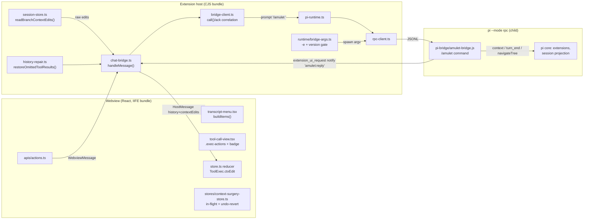
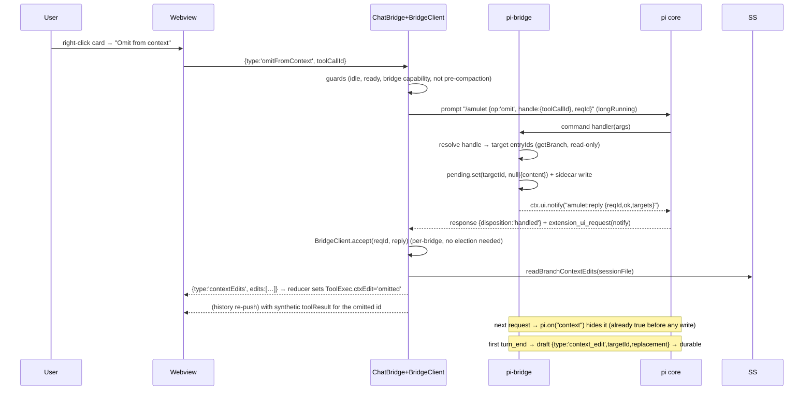
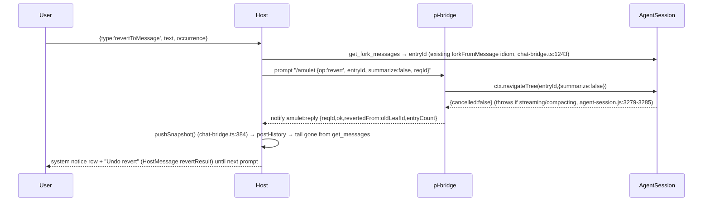

# ARCHITECTURE PLAN — Context Surgery: Omit / Replace / Revert

## 1. Summary

Three user-facing actions on already-written conversation state: **Omit from context** (a tool
result or a reply stops being sent to the model), **Edit context content** (its text is replaced for
future requests, the transcript keeps the original), and **Revert to this message** (everything from a
chosen message to the newest one leaves the model's context). None of them is expressible in today's
Amulet: `pi --mode rpc` exposes a **closed set of 33 commands**
(`pi/dist/modes/rpc/rpc-types.d.ts:13-137`, dispatched at
`pi/dist/modes/rpc/rpc-mode.js:294`, `default:` → `Unknown command` at `:570`) and **not one of them
mutates an existing message or entry**. The capability exists in pi's core data model but is reachable
only from inside the process or from a pi extension: `ContextEditEntry{targetId, replacement}` +
`SessionManager.appendContextEdit()` (`pi/dist/core/session-manager.d.ts:116-128, :288`), the per-request
`context` rewrite hook (`pi/dist/core/extensions/types.d.ts:694-709, :1223`), and
`AgentSession.navigateTree()` (`pi/dist/core/agent-session.js:3279`), which RPC wires **only** into the
extension command context (`pi/dist/modes/rpc/rpc-mode.js:239-246`).

So the real work of this plan is architectural: **Amulet becomes the shipper and owner of a pi
extension** — a new runtime component (`pi-bridge/`, bundled by esbuild, loaded with `-e` at spawn,
version-gated, capability-probed over the existing `get_commands`). On top of that single bridge, all
three features are ordinary host↔webview plumbing. The same APIs exist in pi 1.4.0 (verified at
`/tmp/pisdk/node_modules/@earendil-works/pi-coding-agent`: `rpc-mode.js:240` `navigateTree`,
`session-manager.d.ts:288` `appendContextEdit`, `extensions/types.d.ts:1200` `on("context")`), so the
floor is the version Amulet already targets.

Throughout: `pi` = `/media/jang/home/PortableApp/node/profile/npm-global/lib/node_modules/@earendil-works/pi-coding-agent` (1.5.0) unless a path says 1.4.0.

---

## 2. Feature → primitive map (what is actually possible)

| Feature | pi primitive that does it | Reachable from pure RPC? | Needs `pi-bridge`? | Verified at |
| --- | --- | --- | --- | --- |
| Omit (durable) | `context_edit` entry, `replacement: null` | No | **Yes** (boundary draft) | `session-manager.d.ts:116-128`; `docs/extensions.md:717-746`; `agent-session.js:591-608` |
| Omit (effective on the very next request) | `pi.on("context")` returning filtered messages | No | **Yes** | `extensions/types.d.ts:694-701,1223`; `core/sdk.js:277-281` → `pi-agent-core/dist/agent-loop.js:268-269` |
| Replace text (durable) | `context_edit`, `replacement: { content }` | No | **Yes** | `session-manager.js:236-255` (`projectContextEntry`) |
| Revert / rewind tail | `session.navigateTree(targetId,{summarize})` — "stays in the same file" | No (not an `RpcCommand`) | **Yes** | `agent-session.d.ts:874-885`; `rpc-mode.js:239-246`; `extensions/types.d.ts:326` |
| Read back what is omitted/edited | `get_messages` (projected) / raw session JSONL | **Yes** | No | `rpc-mode.js:534`; `src/session/session-store.ts:95-152` |
| Entry ids for addressing | `get_fork_messages` (`{entryId,text}` per **user** message), `get_entries`, `get_tree` | **Yes** | No | `rpc-mode.js:499,503,515`; `shared/protocol.ts:723-726` |
| Revert target id resolution today | `ChatBridge.forkFromMessage` text-matches `getForkMessages()` | **Yes** | No | `src/webview/chat-bridge.ts:1243` |

### 2.1 Why the live `context` hook is mandatory, not an optimization

The correctness argument that fixes the design:

```
idle: user omits tool result X
      → the durable context_edit can only be appended at a turn boundary
        (ctx.sessionManager is ReadonlySessionManager — extensions have NO append path;
         types.d.ts:242 + pick-list session-manager.d.ts:178)
      → the user then sends a message → the FIRST provider request of that run happens
        BEFORE any turn_end of that run
      → if the omission were durable-only, the model reads X anyway — the exact thing the user clicked against
Hence: the bridge must (a) hold an in-memory override applied in `context` (immediate, per request),
       and (b) flush the durable `context_edit` draft at the first `turn_end` afterwards.
```

### 2.2 Answer to "does Revert avoid a full cache bust?"

`[VERIFIED]` where pi puts Anthropic breakpoints (`pi-ai/dist/api/anthropic-messages.js`): the prompt
blocks (`:917-934`), the last tool definition (`:1313`), and **the last user/system message of every
request** (`:1204-1225`, comment: *"Add cache_control to the last user or system message to cache
conversation history"*), `type:"ephemeral"`, TTL `1h` only under `PI_CACHE_RETENTION=long` (`:24-43`).

Consequences, ordered by confidence:

1. `>85%` **Neither feature busts the system-prompt/tools segment.** A context edit or a revert changes
   message bytes after the head; the head stays identical. This is the cheap half of the request, and it
   is the half Amulet already risks by touching `AGENTS.md`/`SYSTEM.md` (AGENTS.md "cache-bearing" rule).
2. `>85%` **A middle `context_edit` re-prefills everything after the edited entry.** The provider cache is
   prefix-matched; changing a middle entry invalidates every cached prefix containing it.
3. `>85%` **Revert re-prefills strictly less**, because the retained content is a prefix of what was
   already sent, and it is *shorter*: the re-prefill cost is bounded by the retained prefix length, not by
   the old full length, and the abandoned tail is simply gone (it is never re-sent, so it never re-costs).
4. `[HYPOTHESIS]` **Revert may cost near-zero.** Because pi writes a cache entry at *every* turn boundary
   in a session (fact from :1204-1225), reverting to a boundary that was itself the last message of a
   past request means the new request's history prefix matches a cache entry pi already wrote. Subject to
   TTL (5 min default), to no intervening prompt/tool change, and to provider behaviour we do not control.
   **Gate:** must be measured, not believed — Stage 4 acceptance criterion (usage deltas).

`summarize: true` on revert destroys property 3/4 (it appends a branch-summary message and costs an LLM
call, like compaction): **default and only v1 value is `summarize: false`.**

---

## 3. System boundaries



Boundary rule: **the bridge is the only writer, Amulet is the only reader of intent.** Amulet never
writes pi's session file (that would fork the branch — see §8 F-9) and pi never learns about VS Code.

---

## 4. Data flow

### 4.1 Omit / Replace (idle, one tool result)



### 4.2 Revert to this message



### 4.3 State ownership (who can answer "is X omitted?" after a reload)

| Question | Source of truth | Owner file |
| --- | --- | --- |
| Durable edits, current branch | `context_edit` entries in the session JSONL | `src/session/session-store.ts` → `readBranchContextEdits()` |
| Not-yet-persisted edits (idle click, no turn yet) | bridge sidecar `amulet-context-overrides.json` | `pi-bridge/pending-store.ts` |
| Projected (post-edit) transcript | `get_messages` | unchanged path (`pi-runtime.getMessages` 402-404) |
| Card badge + in-flight/undo UI | reducer `ToolExec.ctxEdit`, `stores/context-surgery-store.ts` | webview |

`get_messages` returns `session.messages` (`rpc-mode.js:534`), which `_refreshFinalizedContext()` sets to
the **projected** messages (`agent-session.js:581-587, :1248`). Therefore an omitted tool result
*disappears* from history and a replaced one is indistinguishable from the real output. Repairing that
is a first-class component (§5 `src/webview/history-repair.ts`), not a cosmetic follow-up.

---

## 5. Implementation Blueprint (one row per file)

Signatures are contracts, not implementations. `pi` types are imported as `@earendil-works/pi-coding-agent`
extension-API types (the bridge compiles against them; nothing is bundled from pi — it is a peer).

### 5.1 New — the bridge

| File | Action | Concrete signature (pseudocode) | Depends | Done when |
| --- | --- | --- | --- | --- |
| `shared/bridge-protocol.ts` | create | `export const BRIDGE_COMMAND_NAME = 'amulet'`; `export const BRIDGE_REPLY_PREFIX = 'amulet:reply '`; `export type BridgeOp = 'hello' \| 'omit' \| 'replace' \| 'restore' \| 'revert' \| 'undo-revert'`; `export type BridgeHandle = { kind:'toolCall'; toolCallId:string } \| { kind:'entry'; entryId:string } \| { kind:'userText'; text:string; occurrence?:number }`; `export type BridgeRequest = { v:1; reqId:string; op:BridgeOp; handle?:BridgeHandle; entryId?:string; content?:string; summarize?:false }`; `export type BridgeReply = { v:1; reqId:string; op:BridgeOp; ok:true; targets?:BridgeTargetView[]; revertedFrom?:string; abandonedCount?:number; capabilities?:BridgeCapabilities } \| { v:1; reqId:string; op:BridgeOp; ok:false; error:string; code:BridgeErrorCode }`; `export interface BridgeTargetView { entryId:string; role:'user'\|'assistant'\|'toolResult'; toolCallId?:string }`; `export interface BridgeCapabilities { contextEdit:boolean; navigateTree:boolean; piVersion:string }`; `export type BridgeErrorCode = 'busy'\|'not-idle'\|'unknown-handle'\|'ambiguous-handle'\|'pre-compaction'\|'no-such-entry'\|'cancelled'\|'unsupported'`; `export function encodeBridgeRequest(r: BridgeRequest): string` → `` `/amulet ${JSON.stringify(r)}` `` (single line, `JSON.stringify` escapes newlines); `export function parseBridgeRequestArgs(args: string): BridgeRequest \| { error:string }`; `export function encodeBridgeReply(r: BridgeReply): string`; `export function parseBridgeReply(message: string): BridgeReply \| null` | S0 | `shared/bridge-protocol.test.ts` round-trips every `BridgeOp`, rejects a payload whose first token is not `amulet`, survives content containing `\n`, `"` , `--- pi-extension-context:end ---`-lookalikes, and non-ASCII; `parseBridgeReply` returns `null` for any unrelated `notify` text |
| `pi-bridge/amulet-bridge.ts` | create | `export default function (pi: ExtensionAPI): void` — registers: `pi.registerCommand(BRIDGE_COMMAND_NAME, { description:'Amulet context surgery', handler: async (args: string, ctx: ExtensionContext) => Promise<void> })`; `pi.on('session_start', …)` → `pendingStore.load(sessionFile)`; `pi.on('context', (e) => ({ messages: applyPending(e.messages) }))`; `pi.on('turn_end', (e, ctx) => ({ entries: [...e.entries, ...pendingStore.drafts()] }))`; `pi.on('session_tree', …)` → reload pending from the new branch. Handler algorithm: `parseBridgeRequestArgs` → `resolveTargets` → mutate `pendingStore` or call `ctx.navigateTree` → `ctx.ui.notify(encodeBridgeReply(...))`. Never registers a tool, never registers a system-prompt section. | S0,S1a | `pi -e pi-bridge/dist/amulet-bridge.js` starts, `get_commands` lists `/amulet`; a session prompt with a `hello` request answers a parseable `amulet:reply` notify; `usage.cacheReadInputTokens` of a prompt is unchanged when no edit is pending (proves no prompt-section registration) |
| `pi-bridge/target-resolver.ts` | create | `export interface ResolvedTargets { ok:true; targets: BridgeTargetView[]; groupIds: string[] } \| { ok:false; code: BridgeErrorCode }`; `export function resolveTargets(h: BridgeHandle, sm: ReadonlySessionManager): ResolvedTargets`; `export function expandOmitGroup(target: SessionEntry, branch: SessionEntry[]): string[]` (assistant entry ⇒ itself + every tool-result entry whose `parentId` is that entry; a tool-result entry ⇒ its assistant parent **and** the parent's other tool results only when they belong to the same assistant turn — mirrors pi's own recovery rule, `agent-session.js:875-883` `_omitRecoveryAttempt`); `export function entryIdOfToolCallId(toolCallId: string, sm: ReadonlySessionManager): string \| undefined`; `export function isPreCompaction(entryId: string, sm: ReadonlySessionManager): boolean` | S0,S1a | Unit-testable against a hand-built `SessionEntry[]` fixture: a read tool result resolves to `{assistant entry, that toolResult}`; a second sibling tool result of the same reply is reported as part of the group; two identical user texts resolve `occurrence:'newest'` and report `ambiguous-handle` when `occurrence` is absent |
| `pi-bridge/pending-store.ts` | create | `export type PendingEdit = { targetId: string; replacement: { content: ContextEditableContent } \| null; reqId: string }`; `export class PendingStore { constructor(sessionFile: string) }`; `async load(): Promise<void>`; `set(e: PendingEdit): Promise<void>`; `delete(targetId: string): Promise<void>`; `get(targetId: string): PendingEdit \| undefined` (covers a target inside a group by `groupIds`); `list(): PendingEdit[]`; `drafts(): ContextEditEntryDraft[]`; `prunePersisted(branch: SessionEntry[]): void`; `applyTo(messages: AgentMessage[]): AgentMessage[]` — matching rule: `toolResult`/assistant-by-`toolCall.id` first, exact `(role, text)` for the rest; **never** drop the system message or a `tool_use` block without its `tool_result` (replace instead — see §8 F-3) | S1a | A pending `null` edit removes the tool-result message from `applyTo(messages)` output while keeping the assistant message intact or substituting a placeholder; the sidecar file `amulet-context-overrides.json` written next to the session file survives a process restart and reloads the same map |
| `pi-bridge/sidecar-format.md` (or a doc comment block at the top of `pending-store.ts`) | create | On-disk shape: `{ "v":1, "sessionFile":string, "edits":PendingEdit[] }`, atomic write (`.tmp` + rename), path derived from `ctx.sessionManager.getSessionFile()` | S1c | The file is unreadable ⇒ the bridge logs and starts clean, never throws |

### 5.2 New — host

| File | Action | Concrete signature (pseudocode) | Depends | Done when |
| --- | --- | --- | --- | --- |
| `src/runtime/bridge-args.ts` | create | `export const BRIDGE_BUNDLE_REL_PATH = 'dist/pi-bridge/amulet-bridge.js'`; `export const MIN_PI_VERSION_FOR_BRIDGE = '1.4.0'`; `export function bridgeExtensionPath(extensionDir: string): string`; `export function bridgeSpawnArgs(extensionDir: string, enabled: boolean): string[]` → `[]` or `['-e', bridgeExtensionPath(extensionDir)]`; `export function supportsBridge(agentVersion: string): boolean` (reuses `getAgentVersion` in `src/runtime/bootstrap.ts`) | S1a | `buildStartupArgs` (`src/runtime/bootstrap.ts:138-159`) output for `enabled:true` contains exactly one `-e` pointing at a file that exists inside the packaged extension dir; `pi 1.4.0`/`1.5.0` ⇒ `true`, `0.80.x` ⇒ `false`; the user's own `extraArgs` (`config.ts:25,69`) is still appended last |
| `src/webview/bridge-client.ts` | create | `export class BridgeClient { constructor(private readonly runtime: PiRuntime, private readonly log: Logger) }`; `isAvailable(): boolean` (fed from `get_commands`, cf. `PiRuntime.isExtensionCommand` `pi-runtime.ts:493-496`); `refreshCapabilities(): Promise<BridgeCapabilities \| undefined>` (one `hello` round trip); `call(op: BridgeOp, init: Omit<BridgeRequest,'v'\|'reqId'\|'op'>): Promise<BridgeReply>` — generates `reqId` via `node:crypto.randomUUID()`, stores `{resolve,reject,timer}` in `pending: Map<string, …>`, sends with `runtime.prompt(encodeBridgeRequest(req), undefined, undefined, { longRunning:true })` (mirrors `chat-bridge.ts:811-813`), rejects on `BRIDGE_ACK_TIMEOUT_MS = 15_000` (revert with summary off is fast; `LONG_RUNNING_COMMANDS` budget `rpc-client.ts:47-51` is already generous); `handleNotify(message: string): boolean` — true when consumed (parses via `parseBridgeReply`, matches a `reqId` **owned by this bridge**, so N surfaces never double-apply); `dispose(): void` | S0,S1 | `src/webview/bridge-client.test.ts`: a reply for an unknown `reqId` returns `false` (so the normal toast path still runs); timeout rejects with `code:'busy'`-shaped error and the pending map is cleared in a `finally`; two bridges each holding a different `reqId` each consume only their own reply |
| `src/webview/history-repair.ts` | create | `export function restoreOmittedToolResults(messages: HistoryMessage[], edits: ContextEditRecord[]): HistoryMessage[]` (re-insert a synthetic `role:'toolResult'` message for each omitted `toolCallId`, carrying the **original** content, at the position of its assistant block); `export function markReplacedContent(messages: HistoryMessage[], edits: ContextEditRecord[]): HistoryMessage[]` (keeps projected text, flags the id so the reducer can show "edited") | S2b | Given a captured `get_messages` array where a tool result is missing, the output contains it again with `toolCallId` intact and in the same order relative to its sibling calls; `webview/src/store.ts#seedToolsFromHistory` (258-333) renders a card for it |
| `src/session/session-store.ts` (`readBranchCompactions` `:95`, `scanBranchCompactions` `:132`, `ENTRY_LINK_RE` `:33`, `buildSessionInfo` `:155`) | modify | `export interface ContextEditRecord { targetId: string; kind: 'omitted' \| 'replaced'; replacementText?: string; originalText: string; originalToolCallId?: string; originalRole: 'user' \| 'assistant' \| 'toolResult'; timestamp: string }`; `export function readBranchContextEdits(filePath: string): Promise<ContextEditRecord[]>`; private `scanBranchEdits(...)` beside `scanBranchCompactions` (`:132-152`); it must reuse the existing branch regex prefilter (`ENTRY_LINK_RE` `:33`) and the branch walk, and read the **target** entry to recover `originalText`/`toolCallId` | S2a (shared projection helper) | Reads a fixture session containing two `context_edit` lines (one `replacement:null`, one `{content}`) off the **active branch** only: an edit on an abandoned branch is not returned; today's readers silently skip `type !== 'message'` (`:184`), which stays true for compaction behaviour |
| `shared/session-entries.ts` | modify | `export function collectContextEdits(entries: SessionEntryLike[], leafId: string \| null): Map<string, ContextEditEntryLike>` ("latest edit on the active branch wins", `docs/session-format.md:139-148`); `export function isNewestCompactionCutoff(entries, leafId): string \| undefined` | S2a | `shared/session-entries.test.ts` cases: two edits to one target ⇒ newest; edit on a side branch ⇒ ignored; target id equal to a `firstKeptEntryId` boundary ⇒ reported pre-compaction |

### 5.3 Modified — protocol, config, build

| File | Action | Concrete signature / schema | Depends | Done when |
| --- | --- | --- | --- | --- |
| `shared/protocol.ts` | modify | `WebviewMessage` union (opens `:803`, `editAndFork` variant `:854`): `\| { type:'omitFromContext'; toolCallId: string } \| { type:'replaceContextContent'; toolCallId: string; content: string } \| { type:'restoreContextEntry'; toolCallId: string } \| { type:'revertToMessage'; text: string; occurrence?: 'newest' \| number } \| { type:'undoRevert' }` (pattern-match the existing `editAndFork` variant at `:854`). `HostMessage` union (`:936`, `enterForkMode` variant `:989`): `\| { type:'contextEdits'; edits: ContextEditView[] } \| { type:'revertResult'; revertedFrom: string; abandonedCount: number; ok: boolean; message: string } \| { type:'bridgeStatus'; available: boolean; capabilities?: BridgeCapabilities }`; `export interface ContextEditView { toolCallId?: string; entryId: string; kind:'omitted'\|'replaced'\|'applying'\|'failed'; replacementText?: string; originalText: string; error?: string }`. `RpcEvent`/`RpcCommand` unions: **no change** (deliberate — the bridge speaks an existing command, `prompt`) | S0 | `pnpm run typecheck` green; AGENTS.md rule honoured (protocol first, then host handler, then webview consumer) |
| `src/config.ts` | modify | add `contextEditing: boolean` to `PiConfig` (next to `extraArgs` `:25,69`), default `true`; add `'contextEditing'` to `RESTART_KEYS` (`:185`; the `extraArgs` entry is `:189`) because it changes spawn argv; **not** part of `webviewConfig()` — the bridge status travels on its own `HostMessage` | S1a | Toggling the setting restarts the runtime (`affectsRestart`) and the next spawn carries or drops `-e`; no `pintra.*` twin is consulted (new key, `isExplicitlySet` semantics) |
| `package.json` | modify | `contributes.configuration`: `"amulet.contextEditing": { "type":"boolean", "default": true, "description":"Let Amulet manage what the model can re-read (Omit / Edit context content, Revert). Requires reloading the agent.", "scope":"machine-overridable" }` (mirrors `extraArgs` declaration `:286-295`) | S3a | `pnpm run package` produces a VSIX whose `package.json` has the key; `.vscodeignore` keeps `**/*.ts` out and `dist/**` in |
| `esbuild.mjs` | modify | third build target beside host (`:22-29`) and webview (`:52-59`): `entryPoints: ['pi-bridge/amulet-bridge.ts']`, `outfile: 'dist/pi-bridge/amulet-bridge.js'`, `platform:'node'`, `format:'cjs'`, `target:'node20'`, `bundle:true`, `external: ['@earendil-works/pi-coding-agent', '@earendil-works/pi-ai', '@earendil-works/pi-tui']` | S1a | `pnpm run build` writes the file; `node -e "require('./dist/pi-bridge/amulet-bridge.js')"` exports a function; `pi -e dist/pi-bridge/amulet-bridge.js --mode rpc` starts and answers `hello` |
| `src/runtime/pi-runtime.ts` | modify | none required for the call path (`prompt` `:343-355` suffices). Add `getLoadedExtensionNames(): Promise<string[]>` **only if** capability detection proves unreliable against `getCommands()` `:473-487` | S1b | Bridge availability flips `false → true` after `pushCommands` (`chat-bridge.ts:978-989`) without a restart |
| `src/webview/chat-bridge.ts` | modify | constructor: create `private bridge = new BridgeClient(...)`; `onRuntimeEvent` (`:321-366`) already forwards — add `agent_settled` → `this.bridge.clearUndoContext()`; `handleMessage` (`:409-705`) five new `case`s calling `private async runContextOp(op: BridgeOp, init: …): Promise<void>`; `private async pushContextEdits(): Promise<void>` (called from `pushSnapshot` `:384-407`); `private async revertToMessage(text: string, occurrence?: …): Promise<void>` reusing the resolution idiom of `forkFromMessage` (`:1243-1257`); `postHistory` (`:377-382`) pipeline becomes `stripHistoryImagePayloads(restoreOmittedToolResults(stripCompactionBoundaries(messages), edits))`. **Deliberately not routed through `submitText`/`reportSilentCommand`** (`:794-833`, `:845-866`) — a button click is not a silent command, and `VISIBLE_EVENT_TYPES` (`:98-103`) would mis-score the `notify` ack | S0,S1b,S2b | An `omit` on a runtime with no bridge posts `bridgeStatus{available:false}` + a toast, never a `notice` transcript row; `postHistory` with an omitted tool result still renders the card |
| `src/webview/extension-ui.ts` | modify | in `case 'notify'` (`:71`), first line: `if (await this.tryBridgeReply(message)) return null;` — the interception point before any VS Code toast (`editor`/`input` cases at `:52`,`:61` stay untouched) | S1b | A real `amulet:reply` notify never appears as a VS Code toast; every other extension's notify is unaffected (`src/webview/ui-surfaces.test.ts` extended) |
| `src/webview/ui-request-routing.ts` | modify (conditional) | only if a `notify`-based ack must not count as "user-visible output": nothing today calls `isUserVisibleUiMethod` (`:81-83`) for bridge traffic because bridge calls skip `reportSilentCommand` | S1b | No change needed ⇒ leave alone (verify by grep for `visibleOutput` call sites) |

### 5.4 Modified / new — webview

| File | Action | Concrete signature / schema | Depends | Done when |
| --- | --- | --- | --- | --- |
| `webview/src/store.ts` | modify | `interface ToolExec` (`:42`; cards live in `ChatState.tools: Record<toolCallId, ToolExec>` `:164`, rows in `ChatState.messages` `:163`) gains `ctxEdit?: { kind:'omitted'\|'replaced'\|'applying'\|'failed'; replacementText?: string; error?: string }`; new action `type Action = … \| { type:'contextEdits'; edits: ContextEditView[] }` in the `Action` union (`:527`), handled in the host switch inside `reducer` (`:534`); every tool-rebuild path must carry it: `applyRpcEvent` (`:659`) rebuilds every card on `tool_execution_start/update/end` through `withParentLink` (`:352`) and explicit per-field carry — **an uncopied flag is wiped by the next event**; `seedToolsFromHistory` (`:258`) seeds it from the pending `contextEdits` push that follows history; targeted patch idiom copied from `applyToolImageResult` (`:493`; `mergeToolImages` `:404`): return `state` unchanged when nothing differs (memo comparators depend on identity, `agent-timeline.tsx:110-120`) | S3a | `webview/src/store.test.ts` gains a `context surgery` suite: (1) `ctxEdit` survives a later `tool_execution_update` for the same id; (2) an id with no `ToolExec` yields no state change and no re-render of unrelated cards; (3) a `failed` edit is distinct from `omitted` in state |
| `webview/src/stores/context-surgery-store.ts` | create | `interface ContextSurgeryState { inFlight: Record<string, BridgeOp>; undoRevert?: { revertedFrom: string; abandonedCount: number }; bridgeAvailable: boolean; setInFlight(toolCallId: string, op?: BridgeOp): void; setUndoRevert(v?: …): void; setBridgeAvailable(v: boolean): void }`; `export const useContextSurgeryStore = create<ContextSurgeryState>(…)` (zustand, same pattern as `webview/src/stores/compaction-history-store.ts`) | S3a | In-flight state clears on reply/timeout; store holds **no** transcript content (AGENTS rule: reducer owns chat state) |
| `webview/src/apis/actions.ts` | modify | `omitFromContext: (toolCallId: string) => postMessage({ type:'omitFromContext', toolCallId })`; `replaceContextContent: (toolCallId: string, content: string) => …`; `restoreContextEntry: (toolCallId: string) => …`; `revertToMessage: (text: string, occurrence?: …) => …` — beside `editAndFork` (`:40-41`) | S3a | `webview/src/components/exec-view/tool-call-view.test.tsx` asserts a click posts exactly the expected `WebviewMessage` |
| `webview/src/components/exec-view/tool-call-view.tsx` | modify | `ExecBlock` (`:96`) root `.exec-block` (`:244`) gains `data-tool-call-id={toolCallId}` (the menu resolves targets from DOM, §5.5); `.exec-actions` (`:271`) gains an overflow `<ContextMenuItem>` group rendered by a new local component `function CardMenu({ toolCallId, ctxEdit }: { toolCallId: string; ctxEdit?: ToolExec['ctxEdit'] })`; header (`.exec-header` `:246`) gains `<span className="exec-ctx-badge">Omitted from context</span>` / `Edited in context` when `ctxEdit`; `Edit context content…` opens a **new** dialog component (§5.5 `context-editor-dialog`), never `window.prompt` | S3a,S3b | The badge is visible with the card collapsed; clicking a menu item does not toggle the disclosure (stopPropagation); existing Copy (`:276-289`) and Stop (`:290-307`) behaviour unchanged |
| `webview/src/components/exec-view/exec-block-view.scss` | modify | `.exec-ctx-badge` (same-token styling as the existing header pills on `.exec-header`, `tool-call-view.tsx:246`) and `.exec-menu` — no animation, plain CSS1/2 classes per AGENTS.md. `.exec-joined-prev/-next` (`:39-68`) are dead rules never applied by TSX — do not reuse them | S3c | Badge legible in both themes; `pnpm run build` emits the CSS into the webview bundle |
| `webview/src/components/ui/context-editor-dialog/` (`context-editor-dialog.tsx`, `.scss`, `index.ts`) | create | `function ContextEditorDialog({ initial, title, onConfirm, onCancel }: { initial: string; title: string; onConfirm: (text: string) => void; onCancel: () => void })` — `<textarea>` pre-filled with the **raw** source (`rawSourceOf` in `webview/src/utils/md-units.ts`), never the censored render (AGENTS.md privacy rule), byte counter, Ctrl+Enter submits; mounted like `components/ui/permission-prompt/` | S3c | The dialog receives the untouched output even when a privacy rule is active; cancel sends nothing |
| `webview/src/components/entry-list/transcript-menu.tsx` | modify | `buildItems` (`:70`; hook `useTranscriptMenu` `:54`) gains, for a target with a resolvable `data-tool-call-id`: `Omit from context` / `Edit context content…` / `Restore` (each `disabled` when `inFlight[toolCallId]` or `!bridgeAvailable`, `separatorBefore: true` after the existing Quote/Reply group); for a user bubble, a new `Revert to this message` beside `Branch from here` (`:143`), which needs the same `[data-branch]`-style marker the branch item already requires; menu must keep bailing out (native menu) when it has no items (`AGENTS.md` gotcha) and must snapshot the selection at right-click time | S3a,S3c | Right-clicking plain text still yields the old four items; right-clicking a tool card yields the new ones; `webview/src/components/exec-view/tool-call-view.test.tsx`-style test covers item enablement |
| `webview/src/utils/md-units.ts` | modify | if the Edit dialog needs the untouched text of a *rendered* tool output, expose `rawSourceOf` for tool blocks; note that a terminal `<pre>` has no registered source and is therefore only available censored (AGENTS.md) — the dialog must say so rather than silently offer censored text | S3d | An active privacy rule is either bypassed with a visible notice or blocks the edit — never silently re-injects masked text into the model |

### 5.5 Docs

`PROJECT_OVERVIEW.md`, `PROJECT_OVERVIEW.webview.md`, `AGENTS.md`: add `pi-bridge/` to the Scope Map and
Key Files table, add the "Context surgery" Read-Triggers row, and record the new cache-bearing rule:
*the bridge adds no prompt section, but a context edit is a cache event* (this is the file a future
agent will trust, so it must be exact).

---

## 6. Ordered, atomic build steps

Each step is self-contained; dependencies are named by step number.

1. **S0 — Contract only.** Create `shared/bridge-protocol.ts` + `shared/bridge-protocol.test.ts`; extend
   `shared/session-entries.ts` with `collectContextEdits`/`isNewestCompactionCutoff` + tests. No runtime
   behaviour. **Done when:** `pnpm run test && pnpm run typecheck` green; the protocol test proves the
   single-line JSON round-trip and the `amulet:reply` prefix discrimination.
2. **S1a — Bundle + loader (no behaviour).** `pi-bridge/amulet-bridge.ts` that registers `/amulet` and
   answers `hello` only; `src/runtime/bridge-args.ts`; third esbuild target; `amulet.contextEditing` in
   `src/config.ts` + `package.json`; `-e` appended in `buildStartupArgs` (`bootstrap.ts:138-159`).
   **Depends:** S0. **Done when:** F5 with the setting on → `get_commands` includes `amulet` (visible in
   the Amulet output channel); with the setting off, argv has no `-e`; a user `extraArgs` entry is still
   last; the bundled file exists in `dist/pi-bridge/`.
3. **S1b — Ack channel.** `src/webview/bridge-client.ts` (reqId map, 15 s watchdog, `longRunning` prompt)
   + the `case 'notify'` interception in `src/webview/extension-ui.ts`; `bridgeStatus` HostMessage.
   **Depends:** S1a. **Done when:** a debug palette entry `Amulet: Bridge hello` (temporary, removed in S5)
   shows `{ok:true, capabilities}` in the output channel exactly once per surface, and a non-Amulet
   `notify` from `pi-gate` still toasts; killing the child mid-call rejects the pending promise without
   an unhandled rejection (identity-guarded `onExit`, `pi-runtime.ts` `client !== this.client`).
4. **S2a — Durable-state reader.** `readBranchContextEdits` in `src/session/session-store.ts` + fixtures
   (hand-written JSONL strings inline in the test, following `shared/session-entries.test.ts`).
   **Depends:** S0. **Done when:** edits are returned branch-relative, the abandoned branch is ignored,
   and `originalText` is recovered from the target entry; `listSessions`/`buildSessionInfo` (`:155`)
   and `readBranchCompactions` (`:95`) behave identically on the same fixtures.
5. **S2b — History repair.** `src/webview/history-repair.ts` + wire it into `postHistory`
   (`chat-bridge.ts:377-382`). **Depends:** S2a. **Done when:** a session containing an omitted tool result
   still renders a complete card after a reload (this is the test that fails without this step — verify by
   temporarily disabling the repair).
6. **S3 — UI plumbing.** `shared/protocol.ts` variants, reducer `ToolExec.ctxEdit`,
   `stores/context-surgery-store.ts`, `apis/actions.ts`, `data-tool-call-id`, card menu + badge + SCSS,
   `transcript-menu.tsx` items, `ContextEditorDialog`. **Depends:** S1b. **Done when:** reducer suite in
   `webview/src/store.test.ts` passes the three carry/patch cases; the menu is keyboard-dismissable; no
   `vscode` import appears in webview code.
7. **S4 — Revert end-to-end (first real feature).** `pi-bridge` op `revert` (thin wrapper over
   `ctx.navigateTree(entryId,{summarize:false})`), host `revertToMessage`/`undoRevert`, notice row +
   "Undo revert". **Depends:** S1b,S3. **Done when:** (a) idle revert drops the tail from `get_messages`
   and the webview; (b) attempting revert while a run is active is refused host-side **and** the bridge
   relays pi's own throw (`agent-session.js:3279-3285`) as `{ok:false, code:'busy'}`; (c) Undo returns to
   the original leaf; (d) **cache measurement**: with `scripts/rpc-probe.mjs` capturing
   `tmp/rpc-events.jsonl`, revert-to-previous-turn then one prompt yields
   `usage.cacheReadInputTokens > 0` on the first request, and a middle `replace` on the same session
   yields a larger `cacheWriteInputTokens` — the two numbers are recorded in the PR description, which
   is what converts §2.1 fact 4 from hypothesis to measurement.
8. **S5 — Omit / Replace / Restore end-to-end.** `target-resolver`, `pending-store` + sidecar, `context`
   handler, `turn_end` drafts, host ops, guards. **Depends:** S2a,S2b,S3,S4. **Done when:** (a) after
   `omit`, the *next* model request contains no trace of the output — proven by `rpc-probe` with
   `PROBE_COMMANDS='{"type":"get_messages"}'` plus a `context_edit` line visible in the session file after
   the first `turn_end`; (b) the Anthropic request never contains an orphan `tool_use` (asserted against a
   `before_provider_request`-style capture, or by the fact that the run does not 400); (c) `restore` after
   an omission returns the model's view to the original content; (d) a reload still shows the original
   output **and** the badge.
9. **S6 — Hardening, gates, docs.** Pre-compaction guard in both host (menu enablement) and bridge (final
   authority), `pi < 1.4` degradation (no `-e`, items hidden), cache-cost note in the dialog,
   `pnpm run package`, `pnpm run format`, docs of §5.5. **Depends:** S5. **Done when:** the packaged VSIX
   reproduces S5 acceptance on a clean `~/.pi` (no user packages, project untrusted) and on a machine
   whose `pi` is 0.80.x (falls back to today's behaviour, no `-e`, no crash).

---

## 7. Key decisions and rejected alternatives

1. **Ship a pi extension (`pi-bridge`) rather than an RPC-only feature or an in-process rewrite.**
   Rejected: *(a)* in-process SDK embedding (Pendant's route) — it removes crash isolation, is the whole
   architecture, and contradicts the AGENTS.md process model; *(b)* pure RPC — impossible, the command
   union is closed (`rpc-mode.js:294,:570`); *(c)* polling `get_state` — no write path exists.
2. **Bridge transport = `prompt '/amulet <json>'` + `notify` ack, not a new RPC command.** The `prompt`
   response carries only `{disposition}` (`rpc-mode.js:298-318`, docs `rpc-commands.md:37-42`), so a reply
   must come out-of-band. Rejected: *(a)* writing into `~/.pi/settings.json` + `pi install` (touches user
   config, needs trust, and the Packages dialog would show an Amulet-owned row a user can disable);
   *(b)* a side-channel file the bridge polls (latency, races, and a filesystem watch inside a run);
   *(c)* `setStatus` for the ack (Amulet renders it as a persistent status-bar entry — wrong affordance).
3. **Revert before Omit in the build order.** Revert is one `navigateTree` call with no persistent state,
   no history repair, and no provider-invariant risk — it is the cheapest way to prove the bridge and the
   ack loop. Rejected: shipping the "headline" Pendant feature first, which would have debugged transport
   and projection semantics at the same time.
4. **Address by `toolCallId`, resolve to entry ids inside the bridge.** The webview already has a unique
   `ToolExec.toolCallId` (`store.ts:42-85`) and history messages carry no id at all
   (`rpc-mode.js:534`, `pi-ai` message types have no id field). Rejected: *(a)* `get_entries` from the host
   (multi-megabyte payloads — AGENTS.md already forbids it for lists); *(b)* reading the session file for
   ids (a second parser racing pi's live leaf); *(c)* text-hash handles (collide after an edit).
5. **`navigateTree` (same file) rather than `fork` (new file) for Revert.** `agent-session.d.ts:865` —
   *"Unlike fork() which creates a new session file, this stays in the same file."* Rejected: `fork`
   changes `sessionFile` (Amulet's resume/cache contract, `pi-runtime.ts:504-526`), splits the session list,
   and is already Amulet's meaning of "Branch from here" (`chat-bridge.ts:1260`) — keeping the two
   actions distinct is also what OpenCode does (`revert` vs `Fork to new session`).
6. **`summarize:false` always in v1.** A branch summary is an LLM call and appends content, which is
   exactly what breaks the cache argument of §2.2. Rejected: mirroring `/tree`'s summary prompt — a
   follow-up can add it behind an explicit checkbox and a cost notice.
7. **Idle-only for all three operations (v1).** `navigateTree` throws while streaming/compacting
   (`agent-session.js:3279-3285`); an extension command submitted as `prompt` mid-run risks being queued
   rather than handled (the same class of problem AGENTS.md documents for `steer`/`follow_up`); and pi's
   own documented mid-run repair path is the `turn_end` draft. Rejected: allowing mid-run edits — Pendant
   forbids it too, and the in-memory `context` override still covers "user stops the run, then omits".
8. **Bridge sidecar JSON for the not-yet-persisted window, rather than never persisting.** Rejected:
   appending `context_edit` lines to the session file from the host or the bridge — see F-9.

---

## 8. Failure modes

| # | Failure | Guard (file / function) | Behaviour |
| --- | --- | --- | --- |
| F-1 | `pi` too old for `context_edit`/`navigateTree`, or binary missing | `supportsBridge()` `src/runtime/bridge-args.ts`; capability probe `BridgeClient.refreshCapabilities()` | No `-e` at spawn; menu items hidden; `bridgeStatus{available:false}` disables them host-side too; existing features untouched |
| F-2 | Bridge not loaded (user disabled a package, `-ne`, corrupt `dist`) | `PiRuntime.getCommands()` (`pi-runtime.ts:473-487`) → `BridgeClient.isAvailable()`; 15 s `BRIDGE_ACK_TIMEOUT_MS` | `BridgeReply.code:'unsupported'`/timeout → `ctxEdit.kind:'failed'` badge + toast; optimistic state rolled back |
| F-3 | Provider rejects an orphan `tool_use` (a tool result dropped while its assistant `toolCall` stays) | `PendingStore.applyTo()` + `expandOmitGroup()` (`pi-bridge/`) — omit group = assistant + its tool results, mirroring `_omitRecoveryAttempt` (`agent-session.js:875-883`) | Never a bare drop: either the whole group goes, or the result is replaced by a short placeholder text; the group decision is in the reply (`targets[]`) so the UI shows what actually left context |
| F-4 | Card vanishes from the transcript after a reload | `src/webview/history-repair.ts#restoreOmittedToolResults` fed by `readBranchContextEdits` | Original output re-inserted with the badge; a repair failure degrades to "card hidden + explicit notice row", never a silently shortened history |
| F-5 | Duplicate apply across surfaces (sidebar + N editor tabs share one runtime) | `BridgeClient.pending` is **per bridge** and `handleNotify` claims by `reqId`; reducer patch is idempotent | One reply consumed by the requesting bridge; the resulting `contextEdits` push is per-surface and identical |
| F-6 | Command never resolves because a dialog parks the `prompt` response | `{ longRunning: true }` (the 15-minute budget, `rpc-client.ts:47-51`), the same fix AGENTS.md records for command prompts; plus the ack watchdog | Timeout reports, and the eventual reply is ignored (its `reqId` was dropped) rather than double-applying |
| F-7 | Revert while streaming/compacting | Host gate on `PiRuntime.getStatus()` (`pi-runtime.ts:90-92`) + `state.isStreaming` in the menu; bridge relays pi's throw as `{ok:false, code:'busy'}` | Refusal with the reason, no partial state |
| F-8 | Target already summarized by compaction | `isPreCompaction()` (bridge) + `isNewestCompactionCutoff()` (`shared/session-entries.ts`) for menu enablement | `{ok:false, code:'pre-compaction'}`; the card shows "already compacted away — use Compact instead" |
| F-9 | Two writers on the session file (Amulet or the bridge appending entries directly) | Architectural: the only writer is pi, via `turn_end` drafts (`agent-session.js:591-608`); sidecar lives outside `sessions/*.jsonl` | Prevented by construction — a concurrent append would branch off a stale leaf and silently lose the edit |
| F-10 | Id edit survives the process but not the runtime restart | `PendingStore.load()` on `session_start` from the sidecar; `prunePersisted()` on `session_tree` | Pending edits are restored, then dropped once the projection already contains them |
| F-11 | Revert followed by a stale webview (no event tells the client the leaf moved — `session_tree` is not in the RPC event set) | `BridgeReply.revertedFrom` + `pushSnapshot()` after every successful op (`chat-bridge.ts:384-407`) | Host-driven resync, not event-driven; a lost push self-heals on the next `turn_end`/`agent_end` refresh (`:321-366`) |
| F-12 | Bridge registration silently costs prompt-cache (a stray prompt section / tool) | Acceptance criterion in S1a (unchanged `cacheReadInputTokens`) and `docs` note in §5.5 | Measurable regression caught in Stage 1, not in Stage 5 |
| F-13 | Malformed/hostile payload in the JSON-after-command (the edited text is user-authored and can contain `--- pi-extension-context:end ---`, quotes, newlines) | `JSON.stringify` transport (single line) + `parseBridgeRequestArgs` validation in `shared/bridge-protocol.ts`; the bridge treats an unparseable payload as `code:'unknown-handle'` | Nothing is injected into a prompt: a bridge op never reaches the model as user text, because extension commands write nothing to the session (`disposition:'handled'`, `chat-bridge.ts:814`) |

---

## 9. Red-team critique summary

**Not performed.** The round was waived by instruction ("skip grill-me and red-team"), so there is no
external critique to triage — recorded here rather than fabricated. What substitutes for it is the
evidence-first discipline of §2 (every claim carries a `file:line` from pi's own `dist/` and `docs/`) and
the measurement gate in S4(d), which converts the one claim this plan cannot prove statically — provider
cache behaviour after a revert — into a number before the feature ships.

## 10. Decisions taken on your behalf (flip these if wrong)

The interview round was waived, so these scope calls were made here instead of asked; each is one line to
change and none blocks an earlier stage.

1. **Group-omit semantics.** Omitting a tool result omits its assistant reply and sibling results
   (Pendant's documented rule: *"Omitting a tool call also omits its results"*). Alternative: replace the
   result with a placeholder only, keeping the reply. This costs one branch in `expandOmitGroup`.
2. **File rollback is out of scope.** OpenCode's revert also restores files from snapshots; pi has no
   snapshot mechanism (only `CompactionEntry.details.modifiedFiles`, i.e. a name list, no content). Shipping
   it would require Amulet-owned shadow commits — a separate plan.
3. **Revert targets user messages only in v1** (because `get_fork_messages` already yields their entry ids,
   `chat-bridge.ts:1243`). Assistant-reply targets need the bridge's resolver path built for S5.
4. **A new `amulet.contextEditing` setting, default on.** Alternatives: no setting (no escape hatch if the
   bridge misbehaves), or a per-workspace toggle (wrong scope — it changes spawn argv, so it is
   machine-scoped like `extraArgs`, `package.json:286-295`).
5. **Bridge command name `/amulet`.** It will appear in the user's slash-command menu
   (`extension-commands/`); an underscored/internal name is one constant in
   `shared/bridge-protocol.ts:1`.

## 11. Open questions (unresolvable in this session)

1. **Actual provider cache behaviour after a revert** — needs a live Anthropic session and the numbers from
   S4(d); no static reading of pi can settle it, and it only tunes copy ("this is cheap" vs "this is a
   fresh start"), never the architecture.
2. **Whether `pi -e` with an absolute path into a VSIX `dist/` directory is affected by project-trust
   decisions** on every platform — `pi -e` is resolved by `resolveCliPaths(cwd, parsed.extensions)`
   (`pi/dist/main.js:595`), and Amulet's own trust model (`src/packages/package-settings.ts:70-81`) lists
   `.pi/extensions` as trust-requiring. Needs a run on each OS; if a trusted-project prompt appears, the
   fallback is declaring the bridge as a local pi package, which reuses Amulet's existing
   `resolveProjectTrust` path.

---

## 12. Execution notes (implementation pass)

Built S0–S3, S4 (bridge + host), S5 (bridge + host) and the S6 gates that are runnable here. Every stage's
gate was executed; what could not be executed in this environment is listed under *Pending*, not claimed.

**Verified against the real runtime** (`node scripts/bridge-probe.mjs`, pi 1.5.0, no API key — an extension
command is handled without a provider request, which is what makes this possible):

- `get_commands` lists `amulet`; the bundle loads and answers `hello` with `{contextEdit:true, navigateTree:true}`.
- `omit` on a tool call returns the **group** (`assistant` + its `toolResult`), writes the sidecar, and refuses an
  unknown call with `code:'unknown-handle'`.
- `restore` returns the same group with each entry's untouched content; `replace` addresses the single result.
- `revert` → `{ok:true, revertedFrom, abandonedCount}`, and `get_messages` afterwards shows the tail gone;
  `undo-revert` returns to the abandoned leaf and the projection is whole again (7 messages).
- Gates: `tsc --noEmit` clean, `vitest run` 57 files / 667 tests, `node esbuild.mjs` writes all three bundles.

**Deviations from the plan** (each is one-line reversible):

1. **`pi-bridge/pi-extension-api.ts` instead of a `@earendil-works/pi-coding-agent` devDependency.** The types are a
   declared mirror of pi 1.5.0's extension API, documented as such at the top of the file. Reason: pnpm is not
   installed on this machine (so no lockfile-safe install of a 26 MB types-only dep), and pnpm's strict layout
   would not hoist the transitive `@earendil-works/pi-agent-core` / `pi-ai` that pi's own `.d.ts` files import, so
   the real types would have resolved the messages to `any` anyway. Runtime truth comes from the probe above.
2. **Bridge bundle is ESM `dist/pi-bridge/amulet-bridge.mjs`, not CJS `.js`.** Discovered by loading the CJS bundle
   into real pi: jiti's `import(path, { default: true })` returns the export *namespace* for esbuild's CJS output, so
   pi refuses the extension ("does not export a valid factory function"). Recorded as an AGENTS.md gotcha.
3. **`bridgeSpawnArgs({extensionDir, enabled, agentVersion, log})`** — one options object, so the version floor, the
   setting and the bundle-exists check cannot be passed independently out of sync.
4. **`newestCompactionCutoff` returns the newest boundary entry id** and `isBeforeCompactionCutoff(entries, leafId,
   entryId)` answers the actual question; the plan named only the first.
5. **`markReplacedContent` was not kept**: the `contextEdits` push already carries `replaced` + `toolCallId`, so a
   second channel for the same fact would be dead code.
6. **Pre-compaction is refused by the bridge only** (`code:'pre-compaction'`, surfaced as a `failed` badge with the
   reason); the menu does not pre-disable for it, because the host would have to guess entry ids it does not have.
7. **A mid-run click is refused by the host before the bridge sees it** (`bridgeGate`) and by the bridge
   (`not-idle`), and pi's own `navigateTree` throw is relayed as `code:'busy'` — the plan asked for both, they are
   ordered so the cheap refusal wins.
8. **An `amulet:reply` notify never toasts, on any surface** — not only on the bridge that issued the request.
   Every live surface sees every notify (dialog routing cannot rely on `visible`), so the non-owning copies would
   otherwise show raw JSON to the human. `handleExtensionUiRequest` swallows anything that parses as a bridge ack.
9. **`ContextEditRecord` skips a `custom_message` target** (pi allows editing one): there is no card to badge and no
   text to restore, so the edit stays fully in effect and invisible in the transcript, which is said in the code.
10. **A durable no-op edit is not reported**: a *restore* is itself a `context_edit`, so an entry whose replacement
    equals its original text is dropped from the edit list rather than badging a card as "Edited in context".

**Pending (needs a live model session, i.e. a `pi` that is authenticated):**

- **S4(d) the cache measurement** — §2.2 fact 4 is still a hypothesis. Run with an authenticated `pi`:
  `node scripts/rpc-probe.mjs "<prompt>"` (captures `usage` in `tmp/rpc-events.jsonl`), then revert to the previous
  turn's user message, send one prompt, and read `cacheReadInputTokens` of that first request; then do a middle
  `replace` on the same session and compare `cacheWriteInputTokens`. Record both numbers in the PR.
- **S5(a) the durable write and the request-side proof**: after an idle `omit`, the next run's `context_edit` must
  appear in the session file at the first `turn_end`, and the provider request must contain no trace of the omitted
  output. Everything up to that (draft construction, the `context` hook, the group rule, the orphan guard) is unit
  tested; only the round trip through a real provider call is unmeasured here.
- **S6 on a clean `~/.pi`, an untrusted project, and a `pi 0.80.x` binary**: the degradation paths are coded
  (`supportsBridge`, bundle-exists check, `bridgeStatus{available:false}` hiding the menu items) and the version
  comparison is unit tested, but no install was exercised on those machines.
- **§11.2 `pi -e` and project trust**: unresolved; if a trusted-project prompt ever appears, the fallback recorded
  in the plan is to declare the bridge as a local pi package.

### 12.1 Second-pass review and the semantics it changed

A read-only review of the finished integration (the part no unit test can reach: the state that outlives a single
call) found nine real defects. All are fixed; two changed behaviour and are worth recording:

11. **An omitted tool result is now a *replacement* with `CONTEXT_OMIT_PLACEHOLDER`, not a `null` deletion, and it no
    longer takes its assistant reply with it.** The group rule as written deleted the whole turn from
    `get_messages`, and `restoreOmittedToolResults` could not put it back (its owning reply was gone too), so one click
    on "Omit" silently removed a reply and its card after the next history push — F-4's exact failure. The placeholder
    keeps the request valid (the call is answered), keeps the reply in the model's context (which is what the user
    asked to keep), and the host recognises the placeholder text as an omission for the badge and the transcript.
    `expandOmitGroup` still takes the whole turn when the addressed entry *is* the reply, because then there is nothing
    left to answer the calls. This is the alternative §10.1 named; it costs one branch, as promised.
12. **`PendingStore.prune` also forgets an edit whose target left the branch**, because `appendContextEdit` throws for
    such a target and pi drops the *entire* boundary proposal on a failed draft — an off-branch edit (revert, `/tree`,
    fork) would have voided every later turn's drafts forever, including other extensions'. Related: a `replace` edit
    is now normalised to a block array **before** it is stored, because pi persists it that way and `prune` compares
    content; the un-normalised string never matched, so one click of "Edit context content" would have appended a
    duplicate `context_edit` at every turn.

The rest are state-lifetime fixes: pending badges moved to a per-session-file store shared by all surfaces (F-5 was not
actually met — the other surfaces saw nothing); a `restore` now *clears* the badge instead of claiming an omission; a
refusal is posted once rather than forever; every `bridgeGate` refusal releases the card's in-flight mark; the undo
offer and the in-flight marks die with the session they belong to; `BridgeClient` no longer risks an unhandled
rejection when a command parks past the watchdog, ignores an ack that names the wrong op, and cancels its outstanding
calls when the surface reconnects; `preCompaction` finally reaches the badge (F-8's sentence).

Left as known limitations, deliberately: **duplicate user messages revert to the newest copy** (the protocol carries an
`occurrence`, the transcript menu does not compute it — guessing wrong would discard the wrong span, and a wrong
revert is undoable); and **another surface learns of an idle edit at its next snapshot**, not instantly, because the
in-memory override is not a wire event.
